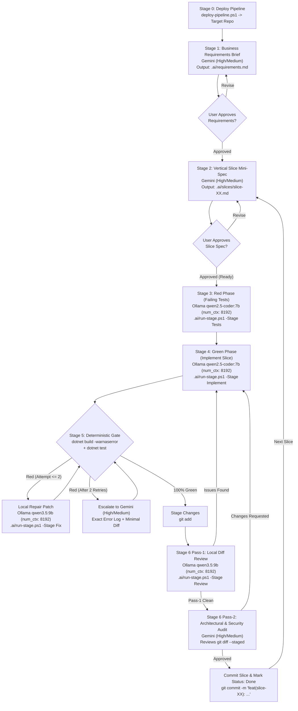

# ZeroCool AI Coding Pipeline — End-to-End Flow

This document describes the complete workflow for building **.NET 10+ (LTS)** applications (Shared RCL + Blazor Server + .NET MAUI Blazor Hybrid for Windows/WiX & Android) using the **ZeroCool AI Coding Pipeline**.

The pipeline pairs **Gemini (High/Medium)** for architecture, slicing, escalation, and final security/design audits with **local Ollama models** (`qwen2.5-coder:7b` and `qwen3.5:9b`) for fast, zero-cost TDD generation, error patching, and Pass-1 diff reviews.

---

## Visual Pipeline Flow



---

## Hardware & Model Routing

- **Local Ollama Endpoint**: `http://localhost:11434` (RTX 4060 8 GB VRAM, 16 GB RAM)
- **Strict Local Context Ceiling**: `num_ctx: 8192` tokens per local Ollama session

| Stage | Purpose | Model | Helper / Skill | Exit Gate |
| :--- | :--- | :--- | :--- | :--- |
| **0** | Bootstrap target repo with rules, skills, constitution & runner | Local CLI | `deploy-pipeline.ps1` | `.agents/` & `.ai/` deployed |
| **1** | Capture goals, user flows, Web/Windows/Android needs, non-goals | **Gemini (High/Medium)** | `pipeline-guide` | `.ai/requirements.md` approved |
| **2** | Break work into vertical slices (contracts, SQL, 3–6 Gherkin scenarios) | **Gemini (High/Medium)** | `pipeline-guide` | `.ai/slices/slice-XX.md` marked `Ready` |
| **3** | Generate failing `xUnit` / `FluentAssertions` / `NSubstitute` / `bUnit` tests | **Ollama `qwen2.5-coder:7b`** | `.ai/run-stage.ps1 -Stage Tests` | Tests fail for expected reason (Red) |
| **4** | Implement production code strictly within slice target files | **Ollama `qwen2.5-coder:7b`** | `.ai/run-stage.ps1 -Stage Implement` | Target files implemented (Green) |
| **5** | Build, test & patch errors (capped at **2 local retries** -> escalate) | **CLI + `qwen3.5:9b`** *(-> Gemini)* | `.ai/run-stage.ps1 -Stage Fix` | `dotnet build -warnaserror` & `dotnet test` green |
| **6** | Two-tier code review on `git diff --staged` & commit | **`qwen3.5:9b` -> Gemini** | `.ai/run-stage.ps1 -Stage Review` | Pass-1 & Pass-2 approved -> `git commit` |

---

## Stage-by-Stage Details

### Stage 0 — Bootstrap & Deploy
Deploy the reusable pipeline templates into any new or existing target repository:
```powershell
cd C:\_GIT\ZeroCoolAICodingPipeline
.\deploy-pipeline.ps1 -TargetRepoPath "C:\_GIT\MyNewApp"
```
- Creates `.agents\rules`, `.agents\skills\feature-slice`, `.agents\skills\pipeline-guide`, and `.ai\slices`.
- Copies `AGENTS.md`, rules, skills, `constitution.md`, `run-stage.ps1`, and `slice-template.md`.
- Re-running later safely updates templates while preserving `.ai\constitution.md` (unless `-Force` is passed) and never overwriting numbered slices (`slice-01.md`+).

### Stage 1 — Business Requirements Brief *(Gemini)*
Open the target repository and say **"Start the pipeline"** (triggers `pipeline-guide`). Gemini interviews you with focused questions and writes `.ai/requirements.md` covering users, primary flows, Web/Desktop/Android nuances, data entities, and v1 non-goals.

### Stage 2 — Vertical Slice Mini-Specs *(Gemini)*
Gemini proposes a numbered slice roadmap and authors `.ai/slices/slice-XX.md` from `.ai/slices/slice-template.md`:
- For a **brand-new app**, **`slice-01.md`** is always the **Walking Skeleton**: `.NET 10+` LTS solution (`*.Shared.UI`, `*.Web` Blazor Server, `*.Maui` Blazor Hybrid with `WindowsPackageType=None`, `*.Tests`), explicit `Program.Main`, base CSS Grid/Flexbox shell, and one smoke/bUnit test.
- Each subsequent slice defines exact target files, DTOs/interfaces, SQL schema, 3–6 compact Gherkin scenarios, and a subtask checklist.

### Stage 3 — Red Phase: Test Generation *(Ollama `qwen2.5-coder:7b`)*
```powershell
.\.ai\run-stage.ps1 -Stage Tests -SlicePath .ai\slices\slice-01.md -IncludeUiRules
```
Generates unit/component tests mapped 1-to-1 to the slice's Gherkin scenarios. Run `dotnet test` to verify they fail for the expected reason.

### Stage 4 — Green Phase: Slice Implementation *(Ollama `qwen2.5-coder:7b`)*
```powershell
.\.ai\run-stage.ps1 -Stage Implement -SlicePath .ai\slices\slice-01.md -TargetFiles tests\MyApp.Tests\SmokeTests.cs -IncludeUiRules
```
Implements the slice strictly adhering to `.ai/constitution.md`, `.agents/rules/csharp-standards.md`, and `.agents/rules/blazor-maui-ui.md`.

### Stage 5 — Deterministic Gate & Local Repair *(CLI + Ollama `qwen3.5:9b`)*
```powershell
dotnet build -warnaserror
dotnet test
```
If either fails, save the concise error output to `.ai\last-error.txt` and run:
```powershell
.\.ai\run-stage.ps1 -Stage Fix -SlicePath .ai\slices\slice-01.md -TargetFiles src\MyApp\Program.cs -ErrorLog .ai\last-error.txt
```
- **Retry Cap**: Maximum **2 local attempts** (`Attempt 1/2`, `Attempt 2/2`).
- If still red after attempt 2, stop local retries and escalate to **Gemini (High/Medium)** with the exact error log and current `git diff`.

### Stage 6 — Two-Tier Quality Gate & Commit *(`qwen3.5:9b` -> Gemini)*
1. Stage the slice's files:
   ```powershell
   git add <slice-files>
   ```
2. **Pass-1 Local Diff Review (`qwen3.5:9b`)**:
   ```powershell
   .\.ai\run-stage.ps1 -Stage Review -SlicePath .ai\slices\slice-01.md -IncludeUiRules
   ```
   Catches missed Gherkin scenarios, rule violations (top-level statements, missing `CancellationToken`, MSIX-only APIs, unparameterized SQL), and obvious defects. Fix any issues and re-run `dotnet build -warnaserror` + `dotnet test`.
3. **Pass-2 Architectural & Security Audit *(Gemini High/Medium — Risk-Gated)***:
   - **`Risk: High`** *(auth, SQL/data, new `I*Service` contracts, MAUI/WiX host, external HTTP, or Stage 5 escalation)*: Review filtered `git diff --staged` with Gemini before committing.
   - **`Risk: Low`** *(CSS/layout tweaks, copy, or established CRUD)*: Pass-1 local review + green `Directory.Build.props` analyzers & tests is sufficient.
4. **Commit, Refresh Repo Map & Reset Context**:
   Mark `slice-XX.md` as `Status: Done`, commit (`git commit -m "feat(slice-XX): <summary>"`), run `.\.ai\update-repo-map.ps1` to keep `.ai\repo-map.md` current for the next Stage 2 spec, and start a fresh Gemini chat for the next slice.

---

## Strict Local Context Budget (`num_ctx: 8192`)

To keep local inference fast and accurate on 8 GB VRAM, `.ai/run-stage.ps1` enforces:

| Always Included (Minimal Payload) | Never Included |
| :--- | :--- |
| `.ai/constitution.md` (< 300 tokens) | Full-repository dumps |
| Active `.ai/slices/slice-XX.md` | Unrelated slices or historical diffs |
| `.agents/rules/blazor-maui-ui.md` *(only with `-IncludeUiRules`)* | `bin/`, `obj/`, lockfiles |
| Explicit `-TargetFiles` for the slice | Verbose MSBuild diagnostic logs |
| Concise `-ErrorLog` *(Stage 5)* or `git diff --staged` *(Stage 6)* | Unstaged or unrelated changes |

Use `-DryRun` on `.ai/run-stage.ps1` at any time to preview the estimated input token count before calling Ollama.

---

## Target Application Architecture Guardrails

Every slice generated by this pipeline enforces:
- **Runtime**: `.NET 10+` (LTS only), `<Nullable>enable</Nullable>`, `-warnaserror`, explicit `public class Program` with `static void Main(string[] args)` (**no top-level statements**).
- **Multi-Target UI**: Shared Razor Class Library (`*.Shared.UI`) hosted by **Blazor Server** (`*.Web`) and **.NET MAUI Blazor Hybrid** (`*.Maui` via `BlazorWebView` for Windows Desktop + Android). No MAUI XAML feature screens.
- **Styling**: Pure **CSS Grid** (2D layouts) and **CSS Flexbox** (1D alignment) with `.razor.css` isolation, mobile-first.
- **Boundaries**: Razor components inject `I*Service` interfaces only—never direct DB or platform APIs.
- **Desktop Packaging**: Unpackaged Windows MAUI builds (`WindowsPackageType=None`) for **WiX** MSI installers; no MSIX-only APIs; user data written to AppData.

